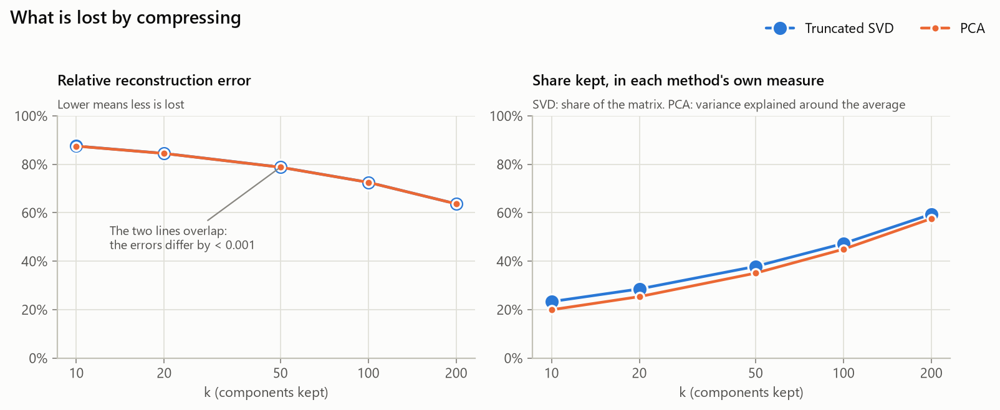
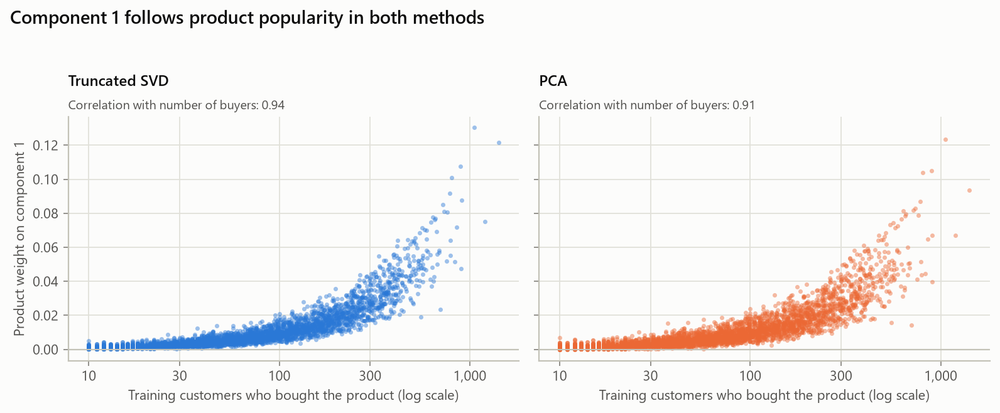

# PCA vs Truncated SVD (ML5)

Generated by `analysis.ipynb` (Section 3). Both methods were fitted on the training matrix
(`matrix_log1p.npz`, 5,456 customers x 3,680 products) with k = 50, the same ARPACK
solver and seed 42. The decision being tested was written before fitting:
[method_decision.md](../method_decision.md).

## Comparison table

| Measure | PCA | Truncated SVD |
| --- | --- | --- |
| k used | 50 | 50 |
| Fit time (seconds) | 0.16 | 0.21 |
| Peak memory during fit (MB) | 7.7 with implicit centring; 490 if centred explicitly | 12.6 |
| Size of stored factors (MB) | 3.68 (factors + 3,680 product averages) | 3.65 |
| Variance explained or relative reconstruction error | 35.1% of variance explained; relative error 0.788 | Relative error 0.788 (keeps 37.9% of the matrix) |
| Hit rate at 10 on held-out purchases | 21.2% cosine; 37.7% rebuilt row | 21.2% cosine; 37.1% rebuilt row |
| Best-seller baseline hit rate at 10 | 26.9% | 26.9% |
| What component 1 represents, in words | Also overall buying, measured from the average customer: 99.8% of products weigh positively (correlation with buyers 0.91). The first contrast between kinds of shops is component 2: home decoration against children's and lunch items. | Overall buying: every product weighs positively, more for popular products (correlation with buyers 0.94); a customer's score follows how much they buy (correlation 0.97). |
| Top 10 for all 5,456 customers (seconds) | 0.23 | 0.23 |

Fit time is the best of 3 runs. Peak memory is what the fit allocates (`tracemalloc`), not counting
the 5.0 MB input matrix. Hit rate at 10 is the share of the 1,903 test customers with
at least one held-out purchase in their top 10. "Cosine" is ML3's rule; "rebuilt row" scores with the
customer's row of A_k (dot products instead of cosines).

## What our numbers show

1. **On this matrix, PCA and SVD give practically the same model.** The average customer that PCA
   removes is only 4.3% of the matrix: centring shifts every zero by
   0.043 on average. The reconstruction errors agree to three decimals
   (0.788 vs 0.788). The first five
   components point the same way (cosine at least 0.985), and the two 50-dimensional
   subspaces agree to 0.982. The "also bought" lists share 96% of their products.
2. **The headline numbers differ only because they divide by different totals.** "Keeps
   37.9% of the matrix" (SVD) and "explains 35.1% of
   the variance" (PCA) describe the same fit. PCA's total leaves out the average customer.
3. **Centring is costly only if it is done by hand.** scikit-learn's implicit centring keeps PCA as
   cheap as SVD (0.16 s against 0.21 s). Centring the
   matrix explicitly makes every one of its 20,078,080 cells non-zero and pushes peak memory to
   490 MB.
4. **Component 1 is overall buying in both methods.** Removing the average does not remove the
   differences in how much customers buy, and those are the biggest variation. The first contrast
   between kinds of shops (home decoration against children's and lunch items) is component 2 in both.
5. **Cosine scoring loses to best sellers; the rebuilt row beats them.** With ML3's cosine rule, SVD hits
   21.2% and PCA 21.2%, against the baseline's
   26.9%. Normalising each product vector to length 1 throws away how much a product sells,
   which is exactly the signal best sellers use. Keeping it (rebuilt row) gives
   37.1% (SVD) and 37.7% (PCA). In PCA's rebuilt
   row, the removed average is worth 2.5 points:
   it scores 35.2% without it. The scoring rule should be chosen in ML3 on a
   validation split, not on these test numbers.
6. **Decision: Truncated SVD stays.** By the rule written in ML1, PCA's largest lead is
   +0.6 points, under the 1-point bar. SVD works on the sparse matrix as it is, needs no
   averages stored, and its error is the "what we lose" number for the memo.

## ML1 predictions against the results

| ML1 prediction | Result | Verdict |
| --- | --- | --- |
| SVD fits at least as fast as PCA and needs less memory | 0.21 s vs 0.16 s; 12.6 MB vs 7.7 MB | Wrong |
| Centring explicitly needs at least 160 MB | Peak 490 MB | Held |
| SVD component 1: one sign for every product, follows popularity | 100% positive; correlation 0.94 | Held |
| PCA component 1: mixed signs, a contrast between two groups | 99.8% positive; correlation 0.91 | Wrong |
| Stored factors about 3.7 MB for both | 3.65 MB vs 3.68 MB | Held |
| SVD's hit rate at least as high as PCA's | Cosine 21.2% vs 21.2%; rebuilt row 37.1% vs 37.7% | Cosine: Held; rebuilt row: Wrong |
| Both methods beat the best-seller baseline | Baseline 26.9% | Cosine: Wrong; rebuilt row: Held |
| Decision rule: switch to PCA if its hit rate is at least 1 point higher | PCA's largest lead: +0.6 points | Decision stands: Truncated SVD |

## Figures

