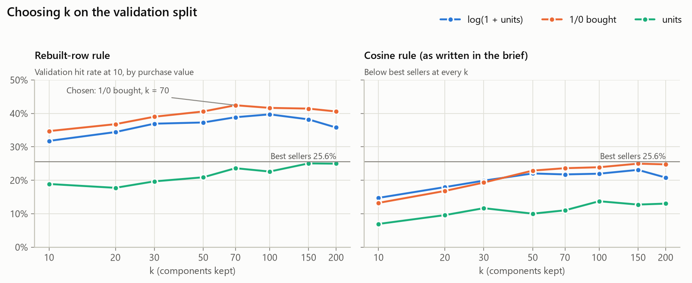
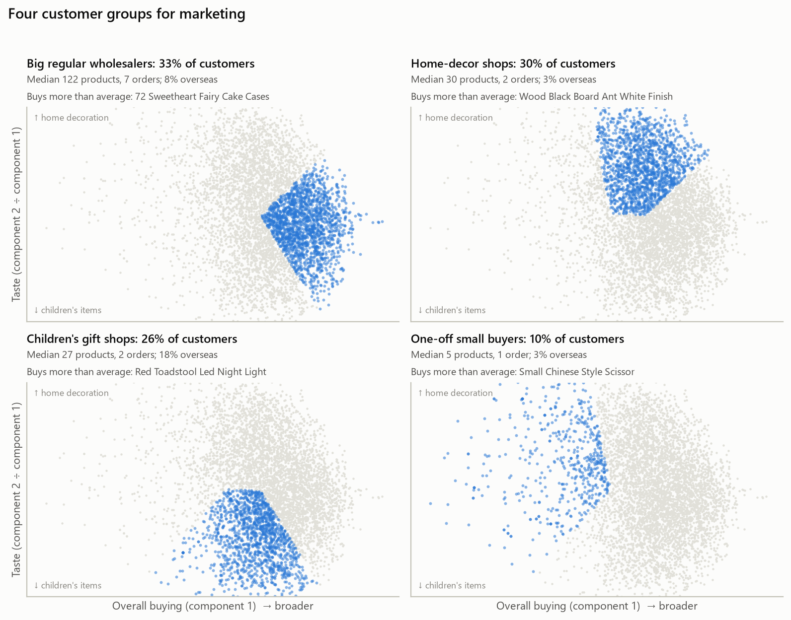

# Results (ML2 to ML7)

Generated by `analysis.ipynb`. Final model: Truncated SVD on the 1/0 bought matrix, k = 70,
rebuilt row scoring rule, all chosen on the validation split ([model_choice.json](model_choice.json)).

## Success targets

| Target | Threshold | Measured | Met |
| --- | --- | --- | --- |
| 1. Shrink the data | Stored factors at least 10x smaller than the full table | 5.1 MB against 160.6 MB: 31x smaller | Yes |
| 2. Runs nightly | Whole nightly job under 1 minute | 0.7 s, peak 327 MB | Yes |
| 3. Beats best sellers | Hit rate at 10 at least 3 points above the baseline | 40.4% against 26.9%: +13.5 points (95% interval +10.9 to +16.1) | Yes |
| 4. Customer groups | 3 to 6 groups, each at least 5%, at most 5 shared top-10 products | 4 groups, smallest 10%, at most 0 shared | Yes |

## ML2: choosing k

On the validation split (1,397 customers, best-seller baseline 25.6%), the
rebuilt row rule on the 1/0 bought matrix scored best: 42.4% at k = 70. The smallest k
within 1 point of that is **k = 70** (42.4%). The brief's cosine rule stayed below best sellers at
every k and purchase value. The relative reconstruction error at k = 70 is 0.809.

## ML4: held-out test purchases

| Recommender | hit rate at 10 |
| --- | --- |
| model: SVD, 1/0 bought, k = 70, rebuilt row rule | 40.4% |
| best-seller baseline | 26.9% |
| for reference: the brief's cosine rule, same model | 24.5% |

1,903 test customers; model minus baseline +13.5 points (95% bootstrap interval
+10.9 to +16.1). The nightly job takes 0.7 s and stores
5.1 MB of factors, against 160.6 MB for the full table.

| Coverage check | Value |
| --- | --- |
| products suggested to at least one customer | 1,083 of 3,680 |
| share of all suggestion slots taken by the 10 best sellers | 5.9% |
| customers whose top 10 is exactly the best-seller list | 0.0% |

## ML6: customer groups

| Segment | Customers | Median products | Median orders | Median spend | Overseas | Distinctive products |
| --- | --- | --- | --- | --- | --- | --- |
| Big regular wholesalers | 33% | 122 | 7 | £2,339 | 8% | 72 Sweetheart Fairy Cake Cases, Jumbo Shopper Vintage Red Paisley, Jam Making Set Printed, Lunch Bag Pink Polkadot |
| Home-decor shops | 30% | 30 | 2 | £600 | 3% | Wood Black Board Ant White Finish, White Hanging Heart T-Light Holder, Wooden Frame Antique White, Painted Metal Pears Assorted |
| Children's gift shops | 26% | 27 | 2 | £462 | 18% | Red Toadstool Led Night Light, Mini Paint Set Vintage, Baking Set Spaceboy Design, Round Snack Boxes Set Of4 Woodland |
| One-off small buyers | 10% | 5 | 1 | £181 | 3% | Small Chinese Style Scissor, Large Chinese Style Scissor, Sandalwood Fan, Antique Silver Tea Glass Engraved |

## ML7: purchase value

| Purchase value | validation hit rate | test hit rate |
| --- | --- | --- |
| log(1 + units) | 38.9% | 37.6% |
| 1/0 bought | 42.4% | 40.4% |
| units | 23.6% | 22.4% |
